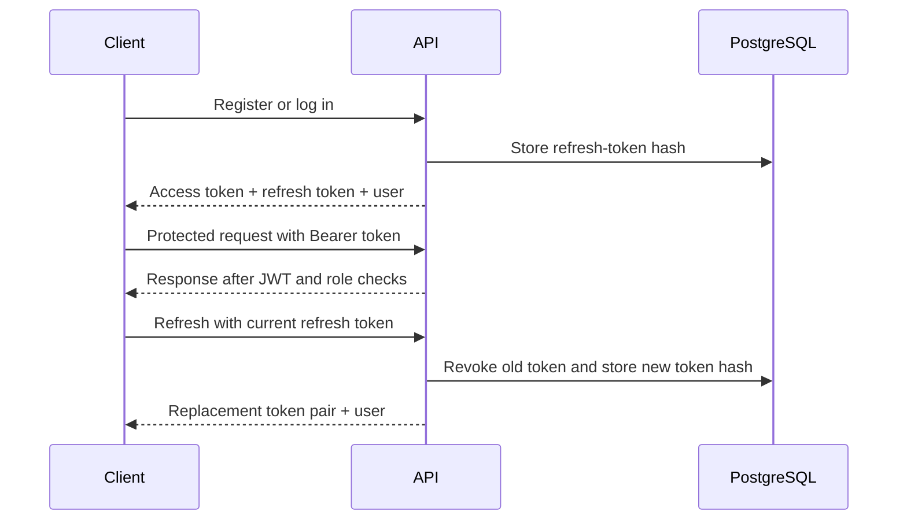

# Authentication

[Back to README](../README.md)

The API returns tokens as JSON. Send the access token in
`Authorization: Bearer <accessToken>`; there is no cookie-based session.
For request and response schemas, use `/swagger` or `/swagger-json` locally.

| Endpoint              | Body                                 | Success                            |
| --------------------- | ------------------------------------ | ---------------------------------- |
| `POST /auth/register` | `email`, `password`, optional `name` | `201`: tokens and user             |
| `POST /auth/login`    | `email`, `password`                  | `200`: tokens and user             |
| `POST /auth/refresh`  | `refreshToken`                       | `200`: replacement tokens and user |
| `POST /auth/logout`   | `refreshToken`                       | `204`: no body                     |
| `GET /auth/me`        | None; requires Bearer token          | `200`: user                        |

The first four endpoints are public. Token responses contain `accessToken`,
`refreshToken` and `user`. The user contains `id`, `email`, `name`, `role`,
`createdAt` and `updatedAt`, never the password hash.

## Token lifecycle

- Access tokens default to **15 minutes**. Authentication reads the JWT's
  user ID, email and role without querying the database. `/auth/me` separately
  fetches the current user.
- Refresh tokens default to **30 days**, with a new expiry on each rotation.
  Only their SHA-256 hashes are stored. Passwords use scrypt.
- A refresh token works once. Reusing a used or revoked token returns `401`
  and revokes the user's other active refresh tokens, including other logins.
  Send only one refresh request at a time and replace both saved tokens on success.
- Logout revokes the supplied refresh token and also succeeds if it is unknown.
  **Existing access tokens remain valid until they expire**, including after
  logout or refresh-token revocation. Clear the client's tokens on logout.
- Role changes take effect in newly issued access tokens. An existing JWT
  retains its original role until expiry.

## Validation and errors

Emails are trimmed and lowercased. Registration passwords must be 8–128
characters; names are optional and, when supplied as strings, trimmed to 1–80
characters. Unknown body fields are rejected, so registration cannot set `role`.

| Status | Common cause                                                                |
| ------ | --------------------------------------------------------------------------- |
| `400`  | Invalid body or unexpected field                                            |
| `401`  | Invalid credentials, missing/expired access token, or invalid refresh token |
| `403`  | Authenticated user lacks the required role                                  |
| `409`  | Email already registered                                                    |
| `429`  | Rate limit exceeded                                                         |

Register and login each allow 10 requests per minute per IP. Other controller
routes use the default limit of 100 per minute per route and IP.

New users get `USER`. Set `role` to `ADMIN` in the database to promote one;
there is no admin-management endpoint. Email verification, password reset,
browser token storage and expired-token cleanup are left to the consuming project.

See [development](development.md) for route decorators and
[operations](operations.md) for configuration and proxy considerations.
